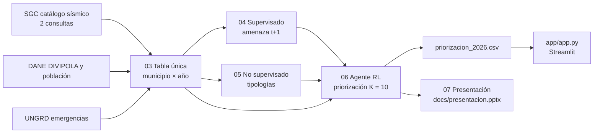
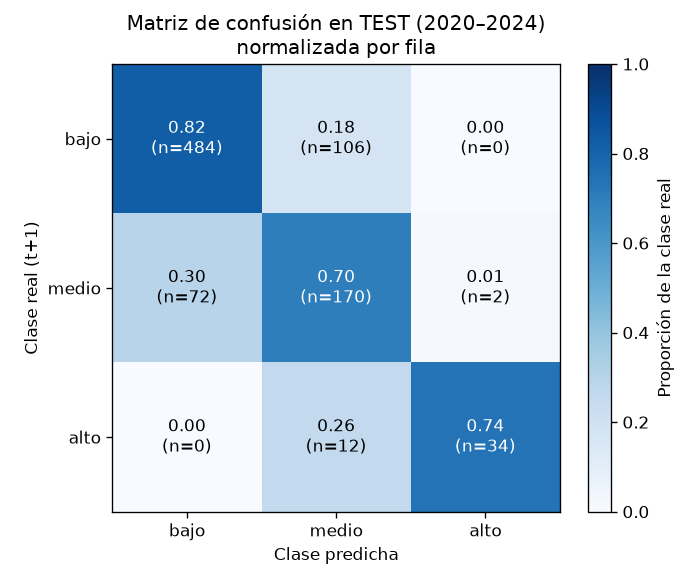
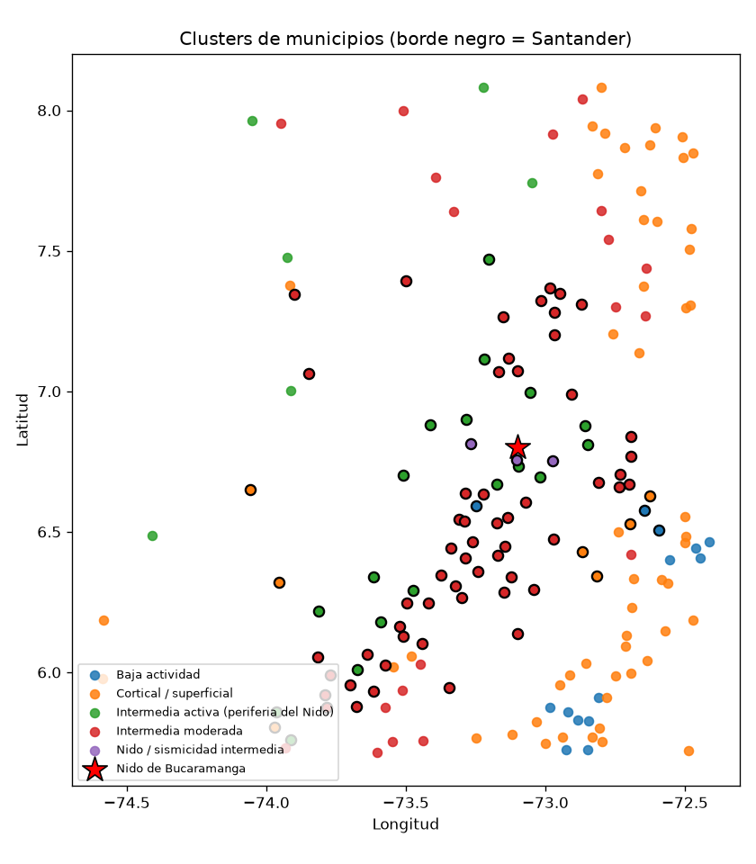
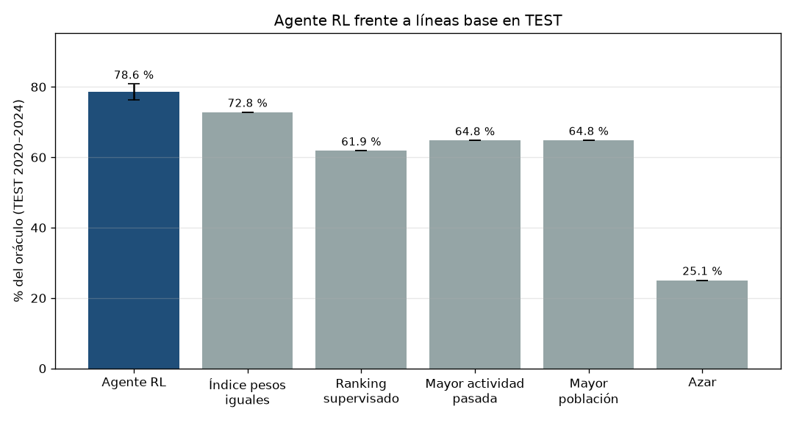
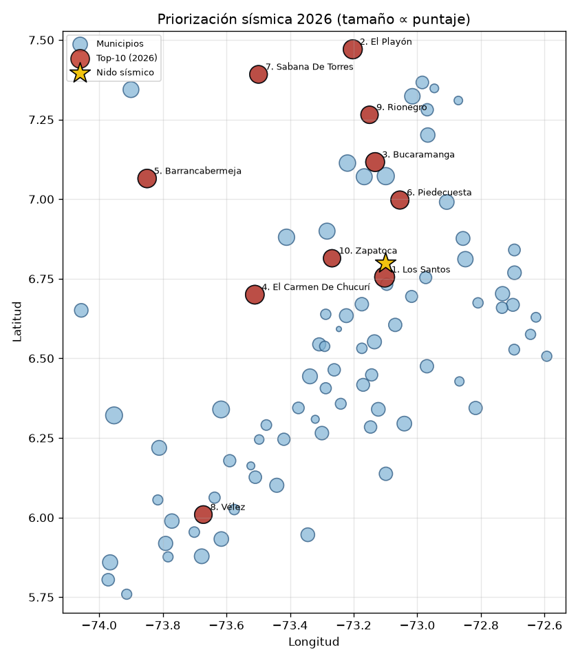

# Santander Inteligente: priorización exploratoria del riesgo sísmico con aprendizaje por refuerzo

**Hackathon CIAI UTSmart 2026 · Reto Avanzado**

> Todas las cifras de este documento se leen de `reports/*.json` y `data/processed/*.csv`, generados por `run_all.py`. No hay números escritos a mano.

---

## 1. Problema

Santander está expuesto a la sismicidad del **Nido sísmico de Bucaramanga**, una zona de sismicidad intermedia bajo la Mesa de Los Santos. En el catálogo, los sismos de esa zona tienen una profundidad media cercana a **148 km**, mucho más profundos que la sismicidad cortical superficial que domina en otras partes del departamento.

**Decisión que se quiere apoyar:** con un presupuesto para **10 estudios o inspecciones al año**, ¿a qué municipios de Santander (87) conviene dar prioridad?

El marco conceptual es:

> **Riesgo = Amenaza × Exposición × Vulnerabilidad**

- **Amenaza:** actividad sísmica observada en el catálogo del SGC.
- **Exposición:** población de cada municipio (DANE).
- **Vulnerabilidad:** emergencias históricas registradas por la UNGRD.

La priorización es **exploratoria**: orienta estudios de microzonificación o inspección. **No predice sismos.**

---

## 2. Solución: tres componentes de ML

| Componente | Pregunta que responde | Modelo | Código |
|---|---|---|---|
| **Supervisado** (amenaza) | ¿Cuántos sismos M ≥ 2,5 tendrá cada municipio el año siguiente: bajo, medio o alto? | RandomForest con validación temporal | `src/04_supervisado.py` |
| **No supervisado** (tipologías) | ¿Qué tipos de comportamiento sísmico existen entre los 176 municipios del recuadro? | K-Means (k = 5), DBSCAN para las fuentes | `src/05_no_supervisado.py` |
| **Agente RL** (priorización) | Dado el estado de un año, ¿qué 10 municipios de Santander priorizar? | REINFORCE con política softmax lineal | `src/06_agente_rl.py` |

Flujo general:



Documentación técnica:

- Casos de uso, componentes, clases, secuencias, actividad y modelo de datos: [`docs/uml/`](docs/uml/) (ver [01](docs/uml/01_casos_de_uso.md), [02](docs/uml/02_componentes.md), [03](docs/uml/03_clases.md), [04](docs/uml/04_secuencias.md), [05](docs/uml/05_actividad_y_estados.md), [06](docs/uml/06_modelo_datos.md)).
- Contratos de datos e interfaces: [`docs/CONTRATOS_DATOS.md`](docs/CONTRATOS_DATOS.md).
- Plan de implementación: [`docs/PLAN_IMPLEMENTACION.md`](docs/PLAN_IMPLEMENTACION.md).
- Plan conceptual y supuestos: [`docs/PLAN.md`](docs/PLAN.md).

---

## 3. Fuentes oficiales

| Fuente | URL | Fecha de descarga (UTC) | Filtros aplicados | Registros |
|---|---|---|---|---|
| **SGC · Red Sismológica Nacional**, consulta 1993–2018 (Earthworm/SEISAN) | https://bdrsnc.sgc.gov.co/paginas1/catalogo/Consulta_Experta/consultaexperta_2.php | 2026-10-13 14:00:06 | Recuadro lat 5,7–8,2 y lon −74,6 a −72,4; magnitud 0–9; profundidad 0–700 km; RMS 0–10 s; GAP 0–360°; errores 0–999 km; periodo 1 jun 1993 – 28 feb 2018 | 111.908 eventos |
| **SGC · Red Sismológica Nacional**, consulta 2018–hoy (SeisComP3) | https://bdrsnc.sgc.gov.co/paginas1/catalogo/Consulta_Experta_Seiscomp/consultaexperta.php | 2026-10-13 14:00:06 | Mismo recuadro y mismos rangos; periodo 1 mar 2018 – 13 oct 2026 | 110.177 eventos |
| **DANE · DIVIPOLA** (datos.gov.co `gdxc-w37w`) | https://www.datos.gov.co/resource/gdxc-w37w.csv | 2026-10-13 13:57:30 | Sin filtro en la descarga. Se usan las 176 cabeceras dentro del recuadro | 1.122 filas (todo el país) |
| **DANE · Proyecciones de población municipal 2020–2035** (base CNPV 2018, post-COVID) | https://www.dane.gov.co/files/censo2018/proyecciones-de-poblacion/Municipal/DCD-area-proypoblacion-Mun-2020-2035-ActPostCOVID-19.xlsx | 2026-10-13 13:57:43 | Sin filtro en la descarga. Se usa el año 2020, área "Total" | Archivo XLSX de 1.878.067 bytes |
| **UNGRD · Consolidado de emergencias 2019–2024** (datos.gov.co `wwkg-r6te`) | https://www.datos.gov.co/resource/wwkg-r6te.csv | 2026-10-13 13:57:35 | Sin filtro en la descarga | 25.857 filas |
| **UNGRD · Consolidado de emergencias 2025** (datos.gov.co `2343-nuqp`) | https://www.datos.gov.co/resource/2343-nuqp.csv | 2026-10-13 13:57:41 | Sin filtro en la descarga | 13.012 filas |

Notas sobre las fuentes SGC:

- Las dos consultas se descargan con los mismos filtros. Se **unifican** al esquema común (fecha UTC, lat, lon, profundidad, magnitud y metadatos de calidad).
- Al unir ambos catálogos hay 222.085 filas crudas. Se eliminan **38 duplicados exactos** sobre (fecha-hora, lat, lon, profundidad, magnitud) y quedan **222.047 eventos**: 111.871 del catálogo 1993–2018 y 110.176 del catálogo 2018–hoy.
- Los metadatos completos (URL, filtros, fecha y conteos) están en `data/raw/metadata_descarga_sgc.json` y `data/raw/metadata_fuentes_complementarias.json`.

---

## 4. Datos

### Tabla única municipio × año

Archivo: `data/processed/dataset_santander.csv`

- **4.224 filas** = 176 municipios × años 2002–2025. Llave única: (`cod_mpio`, `anio`).
- **39 columnas**, con este reparto por rol:

| Rol | Variables | Uso |
|---|---|---|
| Llave | 4 (`cod_mpio`, `nom_mpio`, `dpto`, `anio`) | Identificación |
| Sísmicas (`sup`) | 25 | Entradas del modelo supervisado y del perfil sísmico |
| Territorial | 1 (`es_santander`) | Filtro y comparación territorial |
| Exposición | 2 (`poblacion_total`, `pct_rural`) | Estado y recompensa del agente |
| Vulnerabilidad | 4 (emergencias, movimientos en masa, viviendas y personas afectadas) | Estado y recompensa del agente |
| Objetivo | 1 (`nivel_actividad_t1`) | Variable a predecir |
| Auxiliares futuras | 2 (`n_m25_t1`, `log_energia_t1`) | Solo para construir la recompensa; nunca son entradas |

Diccionario completo, con la justificación de cada variable: [`docs/diccionario_datos.csv`](docs/diccionario_datos.csv).

### Cómo se integraron las fuentes

- **Asignación espacial:** cada sismo se asigna a la **cabecera municipal DANE más cercana** (distancia haversine con `BallTree`). Esta asignación coincide en un **95,3 %** con el municipio que reporta el propio SGC en el catálogo 1993–2018 (111.871 eventos). Es una aproximación de Voronoi; los polígonos oficiales del IGAC quedan como extensión.
- **Códigos:** `cod_mpio` es texto de 5 dígitos según DIVIPOLA. Con ese código se cruzan la población del DANE y las emergencias de la UNGRD.
- **Sismos fuera de Santander:** los 176 municipios del recuadro incluyen 87 de Santander y 89 de departamentos vecinos. Los vecinos sirven como comparación territorial.

### Limpieza

- **Duplicados:** se eliminan 38 duplicados exactos al unir ambos catálogos.
- **Filas incompletas:** se descartan las filas sin latitud, longitud, profundidad o magnitud. En esta corrida no hubo ninguna.
- **Atípicos:** se marcan como atípicos los eventos con RMS > 2 s o error de profundidad > 50 km. Son **607** eventos. Quedan marcados y se excluyen de las variables sísmicas.
- **Completitud de magnitud (Mc):** la red sismológica se densificó con los años, así que el catálogo no es homogéneo en magnitud. Por eso las variables sísmicas usan **solo eventos con M ≥ 2,5 desde 2002**.
- **Cambio de software en 2018:** el paso de Earthworm/SEISAN a SeisComP3 se controla con la variable `periodo_red` (0 = antiguo, 1 = nuevo).
- **Municipio-año sin sismos:** los conteos quedan en 0. Las estadísticas de magnitud, profundidad y calidad usan los valores centinela definidos en [`docs/CONTRATOS_DATOS.md`](docs/CONTRATOS_DATOS.md) (§4).
- **Año 2026:** está incompleto, así que queda fuera de la evaluación. Solo se usa para la priorización final.

### Variable objetivo

`nivel_actividad_t1` clasifica el número de sismos M ≥ 2,5 del municipio **el año siguiente**:

- **bajo:** 0 sismos
- **medio:** 1 a 4 sismos
- **alto:** 5 o más sismos

No es circular: el objetivo usa datos de t+1, y todas las entradas usan solo datos de t o anteriores. Entre los años con objetivo disponible (4.048 observaciones), hay 2.697 bajo, 1.120 medio y 231 alto.

---

## 5. Resultados

### a) Componente supervisado: amenaza del año siguiente

- **Modelo elegido:** `RandomForestClassifier` (`max_depth` 8, `min_samples_leaf` 3), seleccionado con validación temporal 2016–2019. F1-macro de validación: 0,793.
- **Partición temporal:** entrenamiento 2002–2015, validación 2016–2019 y **prueba 2020–2024** (880 observaciones municipio-año).

| Modelo (prueba 2020–2024) | F1-macro | Balanced accuracy | Recall de la clase "alto" |
|---|---|---|---|
| **RandomForest (elegido)** | **0,771** | **0,752** | **0,739** |
| Línea base: persistencia ("igual que el año anterior") | 0,743 | 0,741 | — |
| Línea base: mayoritaria ("bajo") | 0,268 | 0,333 | — |

- **Intervalo de confianza 95 % (bootstrap) del F1-macro:** [0,731; 0,809], con media 0,770.
- **Nota honesta:** el modelo supera a la persistencia por **0,028** puntos de F1-macro. Ese margen es pequeño y el intervalo del modelo **incluye** el valor de la persistencia (0,743). La ventaja no es concluyente.
- **Matriz de confusión (prueba):** filas = clase real, columnas = clase predicha.

| Real \ Predicho | bajo | medio | alto |
|---|---|---|---|
| bajo | 484 | 106 | 0 |
| medio | 72 | 170 | 2 |
| alto | 0 | 12 | 34 |

- **Importancia por permutación (top 5, prueba):**

| Variable | Importancia |
|---|---|
| `n_m25_prom_3a` (promedio de sismos en los 3 años anteriores) | 0,1125 |
| `lon` | 0,0203 |
| `mag_max_historica` | 0,0058 |
| `lat` | 0,0021 |
| `periodo_red` | 0,0000 |

La memoria de actividad reciente domina la predicción. El resto de las variables tiene importancia cercana a cero o negativa.



### b) Componente no supervisado: tipologías territoriales

- **Datos:** perfil sísmico de los 176 municipios (2002–2025), con 11 variables: tasas de sismos M ≥ 2,5, M ≥ 3,0 y M ≥ 3,5, magnitudes, profundidad, fracciones superficial e intermedia, b-value, energía y fracción de años activos.
- **Número de grupos:** **k = 5**, elegido por silueta. La silueta final es **0,538** y el índice de Davies-Bouldin es 0,680.
- **Tipologías y conteo de municipios:**

| Tipología | Santander (87) | Vecinos (89) | Total |
|---|---|---|---|
| Intermedia moderada | 56 | 19 | 75 |
| Cortical / superficial | 7 | 53 | 60 |
| Intermedia activa (periferia del Nido) | 18 | 6 | 24 |
| Baja actividad | 3 | 11 | 14 |
| Nido / sismicidad intermedia | 3 | 0 | 3 |

- **Los Santos** (código 68418) cae en la tipología **"Nido / sismicidad intermedia"**, como se espera.
- **Fuente principal (DBSCAN sobre epicentros y profundidad):** el algoritmo encuentra el Nido **sin habérselo indicado**. La fuente más grande tiene **7.873 eventos**, en lat 6,813 y lon −73,109, con profundidad media de 148,4 km y magnitud máxima 6,3. Las otras dos fuentes tienen 109 y 51 eventos.
- **Variables que más separan los grupos** (árbol sustituto): `pct_superficial` (0,480), `b_value` (0,256) y `pct_intermedio` (0,195).



### c) Componente avanzado: agente de aprendizaje por refuerzo

**Formulación**

| Elemento | Definición |
|---|---|
| **Entorno** | `PriorizacionSantanderEnv` (API de Gymnasium). Un episodio es un año t. Hay 87 candidatos: los municipios de Santander |
| **Estado** | Por candidato: 15 variables estandarizadas (P(alto) y P(medio) del supervisado, memoria sísmica, magnitud histórica máxima, distancia al Nido, 5 indicadores de tipología, población, % rural, emergencias, movimientos en masa y viviendas afectadas), más la bandera "ya elegido" y el presupuesto restante |
| **Acción** | Elegir un municipio que todavía no esté elegido. El episodio termina después de **K = 10** elecciones |
| **Recompensa** | Por cada municipio elegido: `riesgo = amenaza × (0,5 · exposición + 0,5 · vulnerabilidad)`. La amenaza es la energía sísmica observada en t+1, normalizada. El agente **no ve t+1**; solo recibe la recompensa |
| **Algoritmo** | REINFORCE con línea base. Política softmax lineal en numpy. Tasa de aprendizaje 0,05, 300 épocas y **10 semillas** |
| **Entrenamiento** | Años 2006–2015 (validación 2016–2019) |
| **Evaluación** | Años de **prueba 2020–2024**, política determinista (greedy) |

**Resultados en prueba (2020–2024, K = 10)**

| Política | Recompensa media | % del oráculo | Precision@K |
|---|---|---|---|
| **Agente RL (REINFORCE)** | **3,488** | **78,6 %** | **0,614** |
| Índice de pesos iguales | 3,244 | 72,8 % | 0,540 |
| Mayor población | 2,887 | 64,8 % | 0,540 |
| Mayor actividad pasada | 2,847 | 64,8 % | 0,380 |
| Ranking supervisado (por P(alto)) | 2,732 | 61,9 % | 0,340 |
| Azar | 1,106 | 25,1 % | 0,122 |
| Oráculo (información perfecta) | 4,421 | 100 % | — |

- **Lectura:** el agente supera a la mejor línea base (índice de pesos iguales) por **5,8 puntos** porcentuales del óptimo. La desviación entre semillas es de **2,26 puntos**, así que la ventaja sobre ese índice es moderada. Frente a los criterios simples (población, actividad pasada y ranking supervisado) la diferencia es mayor.
- **Precision@K:** fracción del top-10 elegido que coincide con el top-10 del oráculo, promediada por año.

**Pesos principales de la política** (escala estandarizada, media entre semillas)

| Variable | Peso medio | Desviación entre semillas |
|---|---|---|
| `emergencias_log` (vulnerabilidad) | +4,57 | 0,76 |
| `p_alto` (amenaza del supervisado) | +4,00 | 0,55 |
| `log_poblacion` (exposición) | +3,92 | 0,59 |
| `mov_masa_log` (vulnerabilidad) | +2,89 | 0,90 |
| `dist_nido_km` (distancia al Nido) | +2,10 | 0,86 |

Estos pesos son **efectos condicionales**, no causas aisladas. Por ejemplo, `dist_nido_km` sale positivo porque la cercanía al Nido ya entra por `p_alto` y por la tipología. Lo que el agente aprendió es que, dado lo anterior, los municipios con más vulnerabilidad y exposición son los que vale la pena priorizar.



### d) Priorización 2026

Se aplica la política al estado de 2025. Los 87 municipios de Santander tienen un puntaje, una confianza y una explicación (contribución de cada criterio) en `data/processed/priorizacion_2026.csv`.

**Top 10**

| Rango | Municipio | Confianza | Puntaje | Estabilidad (fracción de semillas en el top 10) |
|---|---|---|---|---|
| 1 | Los Santos | alta | 30,53 | 0,90 |
| 2 | El Playón | alta | 25,46 | 1,00 |
| 3 | Bucaramanga | alta | 24,66 | 1,00 |
| 4 | El Carmen de Chucurí | alta | 23,70 | 0,90 |
| 5 | Barrancabermeja | alta | 22,43 | 1,00 |
| 6 | Piedecuesta | alta | 20,46 | 0,80 |
| 7 | Sabana de Torres | alta | 18,46 | 0,80 |
| 8 | Vélez | alta | 18,03 | 0,80 |
| 9 | Rionegro | alta | 16,80 | 0,80 |
| 10 | Zapatoca | media | 16,43 | 0,50 |

- **Confianza en el conjunto:** de los 87 municipios, 9 tienen confianza alta, 2 media y 76 baja. El ranking completo debe leerse con cautela, y el top 10 es más estable que el resto.
- **Bucaramanga (3.º)** entra por **exposición y vulnerabilidad**, no por amenaza: su contribución de amenaza es −2,85, la de exposición 12,30 y la de vulnerabilidad 15,21. Su P(alto) es 0,024. Esto muestra que el ranking mide riesgo y no solo sismicidad.



---

## 6. Cómo reproducir

Requisitos: Python 3.12.

```bash
python -m venv .venv
.venv/bin/pip install -r requirements.txt

# Pipeline completo desde los datos ya descargados (~2 minutos)
.venv/bin/python run_all.py

# Opcional: volver a descargar desde las fuentes oficiales (SGC, DANE, UNGRD)
.venv/bin/python run_all.py --descargar

# Pruebas automáticas
.venv/bin/pytest -q

# Demo en vivo
.venv/bin/streamlit run app/app.py
```

`run_all.py` ejecuta en orden `src/03_tabla.py`, `04_supervisado.py`, `05_no_supervisado.py`, `06_agente_rl.py` y `07_presentacion.py`. Con `--descargar` ejecuta antes `01_descarga_sgc.py` y `02_descarga_fuentes_complementarias.py`. Al final imprime el tiempo de cada paso.

Las semillas son fijas (`config.SEMILLA = 42` y 10 semillas para el agente). En la verificación, dos ejecuciones consecutivas dieron los mismos reportes, salvo diferencias de redondeo de punto flotante.

---

## 7. Estructura del repositorio

```text
.
├── README.md
├── run_all.py                    # orquesta el pipeline (03 → 07; --descargar agrega 01 y 02)
├── requirements.txt
├── src/
│   ├── 01_descarga_sgc.py        # catálogo SGC, dos consultas
│   ├── 02_descarga_fuentes_complementarias.py   # DIVIPOLA, población DANE, UNGRD
│   ├── 03_tabla.py               # tabla única municipio × año
│   ├── 04_supervisado.py         # amenaza t+1 (RandomForest)
│   ├── 05_no_supervisado.py      # tipologías territoriales (K-Means, DBSCAN)
│   ├── 06_agente_rl.py           # agente REINFORCE y priorización 2026
│   ├── 07_presentacion.py        # genera docs/presentacion.pptx
│   └── sismo/                    # librería: catálogo, territorio, features, modelos, RL
├── app/app.py                    # demo Streamlit
├── tests/                        # pruebas con pytest
├── data/
│   ├── raw/                      # descargas oficiales y metadatos JSON
│   ├── interim/                  # eventos unificados y municipios
│   └── processed/                # dataset_santander.csv, clusters, predicciones, priorización 2026
├── models/                       # supervisado.joblib, agente_rl.npz
├── reports/
│   ├── metricas_supervisado.json
│   ├── metricas_no_supervisado.json
│   ├── metricas_rl.json
│   ├── curva_aprendizaje_rl.csv
│   └── figures/                  # figuras en PNG
└── docs/
    ├── PLAN.md, PLAN_IMPLEMENTACION.md, CONTRATOS_DATOS.md
    ├── diccionario_datos.csv
    ├── uml/                      # diagramas y modelo de datos
    └── presentacion.pptx
```

---

## 8. Supuestos, limitaciones y extensiones

**Supuestos y limitaciones**

- **Asignación espacial:** la cabecera más cercana (Voronoi) reemplaza a los polígonos oficiales del IGAC. Coincide en un 95,3 % con el municipio del SGC.
- **Completitud variable:** solo se usan eventos M ≥ 2,5 desde 2002. El cambio de software de 2018 se controla con `periodo_red`, pero puede quedar un sesgo residual de magnitud entre catálogos.
- **Exposición estática:** la población es de DANE 2020 y se usa como constante en todo el periodo. Son proyecciones post-COVID.
- **Vulnerabilidad estática:** la UNGRD solo tiene datos de 2019–2022 y 2025, así que se usa un promedio anual como atributo estructural. Así se evita la fuga temporal en el supervisado.
- **Vulnerabilidad en la comparación:** se usa en el estado y en la recompensa del agente, y también en las líneas base. Por eso la comparación es justa.
- **Riesgo realizado como proxy:** no hay datos de daño por sismo con resolución suficiente. La recompensa es un proxy de riesgo, no una medición del daño.
- **Profundidades negativas en SeisComP3:** son profundidades relativas al nivel del mar. Cuentan como superficiales en las variables de profundidad.
- **Escala de la amenaza:** la normalización de la recompensa usa el máximo de 2006–2015. Incluye t+1 = 2016 y el efecto es despreciable.
- **Pesos de la política:** son efectos condicionales (ver sección 5c). No deben leerse como causas aisladas.
- **Supervisado:** la ventaja sobre la persistencia es pequeña y no es concluyente (ver sección 5a).
- **Priorización exploratoria:** orienta estudios de microzonificación o inspección. **No predice sismos.**

**Extensiones**

- Polígonos oficiales del IGAC para la asignación espacial.
- Amenaza según NSR-10 (aceleraciones Aa y Av).
- Sismicidad histórica con daños (SISH).
- Vulnerabilidad estructural del catastro.
- Recompensas con costo por inspección.

---

## 9. Uso de IA generativa

Se usó **Claude** (Anthropic) como apoyo de programación. Los modelos fueron entrenados por el equipo con datos oficiales del SGC, DANE y UNGRD.

---

## 10. Equipo

- Santiago Afanador Arguello
- Juan Castellanos
