# Plan de implementación — fases y subagentes

**Modelo de trabajo:**
- **Orquestador y supervisor:** Claude Opus 5.5. Diseña, escribe los contratos, despacha las tareas, revisa, corre las verificaciones y aprueba cada compuerta. No escribe la lógica de negocio, salvo en la Fase 0 (andamiaje) y en correcciones puntuales menores de 5 líneas.
- **Ejecutores:** subagentes **Haiku 5.5** (`Agent(model="haiku", subagent_type="general-purpose")`), uno por tarea y con contexto limpio en cada despacho.
- **Documentos base que todo subagente debe leer antes de codificar:**
  1. `docs/CONTRATOS_DATOS.md` (manda sobre todo lo demás)
  2. `docs/uml/03_clases.md` (firmas exactas)
  3. la sección de su tarea en este archivo
  4. (contexto) `docs/PLAN.md` y el diagrama UML relevante

Referencias: [PLAN.md](PLAN.md) · [CONTRATOS_DATOS.md](CONTRATOS_DATOS.md) · UML: [casos de uso](uml/01_casos_de_uso.md), [componentes](uml/02_componentes.md), [clases](uml/03_clases.md), [secuencias](uml/04_secuencias.md), [actividad y estados](uml/05_actividad_y_estados.md), [modelo de datos](uml/06_modelo_datos.md)

---

## Mapa de fases

```mermaid
gantt
    title Implementación (martes 13 oct · cierre 12:00)
    dateFormat HH:mm
    axisFormat %H:%M
    section Fase 0 · Orquestador
    Andamiaje config + requirements + git   :f0, 09:20, 10m
    section Fase 1 · Datos
    T1.1 catalogo (Haiku A)                 :t11, after f0, 20m
    T1.2 territorio (Haiku B)               :t12, after f0, 20m
    T1.3 features + 03_tabla (Haiku C)      :t13, after t11, 20m
    Compuerta G1                             :milestone, g1, after t13, 0m
    section Fase 2 · Modelos
    T2.1 supervisado (Haiku D)              :t21, after t13, 25m
    T2.2 no supervisado (Haiku E)           :t22, after t13, 25m
    Compuerta G2                             :milestone, g2, after t21, 0m
    section Fase 3 · RL
    T3.1 entorno + agente (Haiku F)         :t31, after f0, 30m
    T3.2 evaluacion_rl + 06 (Haiku G)       :t32, after t21, 25m
    Compuerta G3                             :milestone, g3, after t32, 0m
    section Fase 4 · Producto
    T4.1 app Streamlit (Haiku H)            :t41, after t32, 20m
    T4.2 README + run_all (Haiku I)         :t42, after t32, 15m
    T4.3 presentación pptx (Haiku J)        :t43, after t32, 20m
    Compuerta G4 + push                      :milestone, g4, after t41, 0m
```



**Paralelismo clave:**
- T1.1 ∥ T1.2 ∥ **T3.1**: el entorno y el agente RL solo dependen de los contratos, no de los datos. Se prueban con datos sintéticos de *test* (que no son fuente de datos).
- T2.1 ∥ T2.2.
- T4.1 ∥ T4.2 ∥ T4.3.
- Como mucho **3 subagentes simultáneos**, y cada uno es dueño exclusivo de sus archivos.

---

## Fase 0 — Andamiaje (orquestador, 09:20–09:30)

| Entregable | Detalle |
|---|---|
| `src/sismo/__init__.py`, `src/sismo/config.py` | Constantes exactas de CONTRATOS §1, incluidas las listas `FEATURES_*` |
| `requirements.txt` | pandas, numpy, scikit-learn, gymnasium, matplotlib, seaborn, plotly, streamlit, openpyxl, requests, joblib, python-pptx, pytest |
| `.gitignore` | `.venv/`, `__pycache__/`, `data/raw/*.html`, `data/raw/sgc_1993_2018_*.xlsx`, `*.log` (se conservan los CSV crudos consolidados y los JSON de metadatos) |
| Carpetas | `data/interim`, `data/processed`, `models`, `reports/figures`, `tests`, `app` |
| Git | `git add` de los docs + config + scripts 01/02 · commit inicial (el push espera la aprobación del usuario) |
| Verificación | `.venv/bin/python -c "import sys; sys.path.insert(0,'src'); from sismo import config; print(config.ROOT)"` |

---

## Fase 1 — Datos

### T1.1 · `src/sismo/catalogo.py` + `tests/test_catalogo.py` — Haiku A
- **Lee:** `data/raw/sgc_1993_2018.csv`, `data/raw/sgc_2018_hoy.csv`.
- **Implementa:** las funciones de `catalogo` del diagrama de clases. `construir_eventos()` devuelve el DataFrame de CONTRATOS §2 **sin** `cod_mpio` ni `dist_cabecera_km` (esas columnas las agrega T1.3 con `territorio.asignar_municipio`).
- **Reglas:** mapeo de columnas, eliminación de duplicados exactos (sobre fecha_hora_utc, lat, lon, prof_km, mag), `es_atipico` y `event_id`.
- **Tests:**
  - Con un DataFrame pequeño construido en el test: renombrado correcto, eliminación de duplicados y regla de atípico.
  - Smoke test sobre los datos reales: más de 200.000 filas, años entre 1993 y 2026, sin NaN en lat, lon, prof ni mag.
- **Aceptación:** `pytest tests/test_catalogo.py -q` en verde. Imprime el conteo por catálogo y el número de atípicos.

### T1.2 · `src/sismo/territorio.py` + `tests/test_territorio.py` — Haiku B
- **Lee:** `dane_divipola.csv`, `dane_proyeccion_poblacion_municipal_2020_2035.xlsx`, `ungrd_emergencias_2019_2024.csv`, `ungrd_emergencias_2025.csv`.
- **Implementa:** las funciones de `territorio`. `construir_municipios()` devuelve CONTRATOS §3. `asignar_municipio(eventos, municipios)` agrega `cod_mpio` y `dist_cabecera_km` con `sklearn.neighbors.BallTree(metric="haversine")`.
- **Tests:**
  - `distancia_km` entre Bucaramanga (7,119, −73,122) y Los Santos (6,755, −73,105) ≈ 40 km (±3).
  - 176 municipios, 87 de Santander, `cod_mpio` de 5 caracteres y único.
  - Población no nula en al menos 99 % de los municipios.
  - Smoke test de `asignar_municipio` con 3 puntos conocidos.
- **Aceptación:** tests en verde. Imprime el porcentaje de cruce con DANE y con UNGRD.

### T1.3 · `src/sismo/features.py` + `src/03_tabla.py` + `tests/test_features.py` — Haiku C (después de T1.1 y T1.2)
- **Implementa:**
  - Las funciones de `features`. `construir_dataset()` encadena: `catalogo.construir_eventos` → `territorio.construir_municipios` → `asignar_municipio` → guarda `interim/eventos_unificados.csv` y `interim/municipios.csv` → `agregar_anual` (panel 1999–2025, rellenado con 0) → `agregar_rezagos` → `agregar_objetivo` → `unir_territorio` → recorte a 2002–2025 → validaciones → guarda `processed/dataset_santander.csv`.
  - `diccionario_datos()` genera `docs/diccionario_datos.csv`, con una justificación escrita para **cada** variable (en español y de una línea).
  - `03_tabla.py` es un script delgado que llama a `construir_dataset()` e imprime: forma, distribución de `nivel_actividad_t1` por split y número de variables.
- **Tests:**
  - `b_value_aki` con magnitudes sintéticas de Gutenberg-Richter con b = 1 → 1,0 ± 0,15.
  - `nivel_actividad` con [0, 1, 4, 5, 20] → [bajo, medio, medio, alto, alto].
  - El objetivo de la fila t es igual a n_m25 de la fila t+1 del mismo municipio.
  - Ninguna columna de `FEATURES_SUP` termina en `_t1`.
- **Aceptación:** tests en verde, 4.224 filas y todas las validaciones de CONTRATOS §4 pasan.

### 🚦 Compuerta G1 (orquestador)
- [ ] `python src/03_tabla.py` corre de cero en menos de 3 minutos.
- [ ] Hay 4.224 filas, más de 20 variables y el diccionario completo y sin justificaciones vacías.
- [ ] Revisión de fuga: ninguna variable de entrada usa t+1, y los rezagos usan solo t−1..t−3.
- [ ] Revisión manual: Los Santos tiene la mayor n_m25; las clases están razonablemente distribuidas (se reporta el % por split).
- [ ] Si hay desbalance extremo (alto < 5 % en train), el orquestador ajusta `UMBRAL_ALTO` en config y lo documenta.

---

## Fase 2 — Modelos

### T2.1 · `src/sismo/supervisado.py` + `src/04_supervisado.py` + `tests/test_supervisado.py` — Haiku D
- **Implementa:** las funciones de `supervisado` (diagrama de clases y CONTRATOS §6).
- **Selección de modelo:**
  - Candidatos: `RandomForestClassifier(n_estimators=300, class_weight="balanced_subsample", random_state=SEMILLA, n_jobs=-1)` con una rejilla `{max_depth: [None, 8, 14], min_samples_leaf: [1, 3, 8]}` y `HistGradientBoostingClassifier(class_weight="balanced", random_state=SEMILLA)` con una rejilla `{learning_rate: [0.05, 0.1], max_depth: [None, 6]}`.
  - Se ajusta con TRAIN y se elige por F1-macro en VAL. Luego se reentrena con TRAIN+VAL y se evalúa en TEST.
- **Líneas base:** la clase mayoritaria y la *persistencia* (la clase del año t según n_m25 de t con los mismos umbrales).
- **Incertidumbre:** 1.000 remuestreos bootstrap de la F1 en TEST (IC 95 %).
- **Importancias:** `permutation_importance` en TEST (n_repeats = 5).
- **Walk-forward:** para cada t de 2006 a 2025, se entrena con los params elegidos usando `anio ≤ t−1` y `y` no nulo, y se predice `anio == t`.
- **Guarda:** `models/supervisado.joblib` (modelo final + lista de features), el JSON de métricas, el CSV de predicciones y 2 figuras.
- **Tests:**
  - `dividir_temporal` no solapa años.
  - En el walk-forward, el año máximo de entrenamiento es menor que t.
  - Las probabilidades suman 1.
- **Aceptación:** tests en verde. El JSON existe y cumple el esquema. El modelo supera a la línea base mayoritaria en F1-macro de TEST; si no supera a la persistencia, se reporta con honestidad.

### T2.2 · `src/sismo/no_supervisado.py` + `src/05_no_supervisado.py` + `tests/test_no_supervisado.py` — Haiku E
- **Perfil municipal:** `FEATURES_PERFIL`, calculado desde el dataset (y desde eventos para b_value y prof).
- **Elección de k:** `elegir_k` con k = 2..8: silueta, Davies-Bouldin, inercia y BIC de `GaussianMixture`. Se elige k por la silueta máxima con k ≥ 3, para que la interpretación sea útil.
- **Ajuste:** `KMeans(n_init=20, random_state=SEMILLA)`.
- **Nombres de los grupos:** `nombrar_clusters` usa reglas sobre los centroides en unidades reales:
  - mayor `pct_intermedio` → "Nido / sismicidad intermedia"
  - mayor `pct_superficial` con tasa alta → "Cortical activa"
  - tasa mínima → "Baja actividad"
  - el resto → "Moderada"
  - Si hay nombres repetidos, se les agrega un sufijo numérico.
- **Comparación territorial:** tabla cruzada dpto × cluster, y Santander contra los vecinos.
- **Importancia de variables:** un `DecisionTreeClassifier(max_depth=4)` sustituto que predice el cluster → `feature_importances_`.
- **Fuentes por DBSCAN:**
  - Sobre los epicentros M ≥ 3,0 no atípicos (lat y lon en km, prof en km), escalados con `StandardScaler`, `eps=0.3`, `min_samples=30`.
  - Se ajusta eps hasta 0,6 si sale menos de 1 cluster.
  - Se reporta el top 5 de fuentes. Se espera que el Nido aparezca a unos 6,8° N, −73,1° O y 140–160 km de profundidad.
- **Agente RL:** el mismo pipeline se ajusta con un perfil de solo 2002–2015 y genera `cluster_rl`, con el mismo k.
- **Guarda:** el CSV, el JSON y 4 figuras.
- **Tests:**
  - El perfil tiene 176 filas y no tiene NaN.
  - Las etiquetas de cluster están en [0, k).
  - `nombrar_clusters` devuelve k nombres únicos.
- **Aceptación:** tests en verde, silueta mayor que 0,2 y Los Santos en el cluster "Nido".

### 🚦 Compuerta G2 (orquestador)
- [ ] Los dos scripts corren de cero.
- [ ] Los JSON cumplen el esquema.
- [ ] Las métricas tienen sentido (sin F1 = 1,0 sospechoso, que indicaría fuga).
- [ ] `predicciones_supervisado.csv` cubre 2006–2025 × 176.
- [ ] Revisión de las figuras.

---

## Fase 3 — Agente de refuerzo (el componente más importante: 20 pts)

### T3.1 · `src/sismo/entorno_rl.py` + `src/sismo/agente_rl.py` + `tests/test_entorno_rl.py` + `tests/test_agente_rl.py` — Haiku F (**arranca en paralelo con la Fase 1**)
- **Implementa** `PriorizacionEnv` (hereda de `gymnasium.Env`) y `AgentePoliticaLineal` *exactamente* como en `uml/03_clases.md` §"Semántica clave".
- **Softmax numéricamente estable:** se resta el máximo antes de exponenciar. Las posiciones con máscara se excluyen.
- **Gradiente de la entropía:** `∇H = −Σ_j π_j (log π_j + 1) (x_j − x̄)`, donde `x̄ = Σ π_j x_j`. Se puede usar la aproximación simple `−Σ π_j log π_j · (x_j − x̄)`.
- **Tests (con datos sintéticos de prueba, no como fuente de datos):**
  - `gymnasium.utils.env_checker.check_env` pasa (o se documenta la advertencia si el espacio de observación es 2D).
  - Un episodio termina exactamente en K pasos con acciones válidas.
  - Una acción repetida da −1 y no cambia el presupuesto.
  - `oraculo` es igual a la suma del top-K.
  - **Aprendizaje:** en un entorno sintético donde la recompensa es `x[:,0]`, tras 300 episodios el `w[0]` aprendido es mayor que 0 y el % del oráculo en modo greedy supera el 90 %.
  - `guardar` y `cargar` hacen ida y vuelta sin perder información.
- **Aceptación:** `pytest tests/test_entorno_rl.py tests/test_agente_rl.py -q` en verde.

### T3.2 · `src/sismo/evaluacion_rl.py` + `src/06_agente_rl.py` — Haiku G (después de G2 y T3.1)
- **Implementa:** las funciones de `evaluacion_rl` según CONTRATOS §6.
  - `construir_estados` une el dataset (solo Santander), las predicciones walk-forward, `cluster_rl` y los municipios. Estandariza con TRAIN_RL y calcula las recompensas.
  - `entrenar` hace `RL_EPOCAS` épocas; cada época recorre una vez cada año de TRAIN_RL en orden aleatorio. Cada 10 épocas mide el % del oráculo greedy en VAL_RL y lo registra en la curva.
  - `lineas_base`: azar (con 20 repeticiones), mayor población, mayor actividad pasada (`n_m25_prom_3a`), ranking supervisado (`p_alto`) e índice de pesos iguales (media de p_alto, exposición y vulnerabilidad normalizadas).
  - `evaluar_politica` corre en TEST_RL en modo greedy y calcula la recompensa media, el % del oráculo y la precision@K.
  - `priorizar` se aplica sobre el estado de anio 2025 con los 10 agentes y produce `priorizacion_2026.csv`.
- **`06_agente_rl.py`:** un agente por semilla en `SEMILLAS_RL`. Guarda el npz, el JSON, la curva CSV, el CSV de priorización y 4 figuras. Imprime una tabla comparativa.
- **Aceptación:**
  - Corre en menos de 5 minutos.
  - Hay 87 filas de priorización.
  - El agente RL supera al azar en TEST (si no supera a todas las líneas base, se reporta tal cual; **no se maquillan los datos**).
  - Los pesos de la política son interpretables (se reportan con signo).

### 🚦 Compuerta G3 (orquestador)
- [ ] Revisar que la recompensa nunca se filtre al estado (`log_energia_t1` y `n_m25_t1` no están en `FEATURES_RL`).
- [ ] La curva de aprendizaje es creciente o estable.
- [ ] La tabla contra las líneas base es coherente.
- [ ] El ranking 2026 tiene sentido geográfico (Los Santos, Piedecuesta, Bucaramanga y Zapatoca deberían aparecer arriba).
- [ ] Si el agente RL queda por debajo del índice simple, el orquestador decide si ajustar lr/épocas (1 iteración máximo) o presentarlo como un hallazgo honesto.

---

## Fase 4 — Producto

### T4.1 · `app/app.py` — Haiku H
- **Requisitos generales:**
  - Streamlit, `st.set_page_config(layout="wide", page_title="Priorización sísmica Santander")`.
  - Solo lee artefactos, con `@st.cache_data`.
  - Si falta un artefacto, muestra `st.error` con el comando para generarlo.
- **Pestañas:**
  1. **Problema y datos:** contexto del Nido, fuentes con URL/fecha/filtros (desde los `metadata_*.json`), número de filas y variables, y el diccionario en un `st.dataframe`.
  2. **Supervisado:** KPIs (F1 de test frente a las líneas base, IC bootstrap), la matriz de confusión y las importancias.
  3. **No supervisado:** el mapa de clusters (plotly `scatter_map` sobre `open-street-map` centrado en 7,0, −73,3 con zoom 7; si falla, `scatter_geo`), la comparación territorial y los centroides.
  4. **Agente RL:** un diagrama textual de entorno/estado/acción/recompensa, la curva de aprendizaje, la comparación con las líneas base y los pesos de la política.
  5. **Priorización 2026:** slider K (5–20, por defecto 10), el mapa con el tamaño según el puntaje y el color según la confianza, la tabla top-K, y una ficha del municipio seleccionado con sus contribuciones por criterio y su serie histórica de n_m25.
- **Aceptación:** `streamlit run app/app.py --server.headless true` arranca sin excepciones. El orquestador lo verifica en el navegador integrado.

### T4.2 · `README.md` + `run_all.py` — Haiku I
- **README** con estas secciones:
  - Problema
  - Arquitectura (enlaces a `docs/uml`)
  - Fuentes oficiales citadas (URL + fecha de descarga + filtros, leídos de los JSON de metadatos)
  - Cómo reproducir (`python -m venv`, `pip install -r requirements.txt`, `python run_all.py`, `streamlit run app/app.py`)
  - Resultados (las métricas se leen de los JSON en el momento de escribir y se pegan como tabla)
  - Supuestos, limitaciones y extensiones (de PLAN.md §8)
  - Equipo
- **`run_all.py`:** corre los scripts 03 → 07 con `subprocess.run([sys.executable, ...], check=True)`, mide el tiempo de cada paso e imprime un resumen. La flag `--descargar` también corre el 01 y el 02.

### T4.3 · `src/07_presentacion.py` → `docs/presentacion.pptx` — Haiku J
- python-pptx, 16:9, unas 10 diapositivas que encajan en 10 minutos:
  1. Título y equipo
  2. Problema: Santander y el Nido
  3. Datos e integración (las 4 fuentes, la tabla única y más de 20 variables)
  4. Arquitectura del flujo
  5. Supervisado: métricas contra las líneas base
  6. No supervisado: mapa de clusters y comparación territorial
  7. Agente RL: formulación
  8. Agente RL: resultados contra las líneas base y la curva
  9. Priorización 2026: mapa y top-10
  10. Impacto, limitaciones y extensiones
- Usa las figuras de `reports/figures`. Los textos y cifras se leen de los JSON, sin números escritos a mano.
- **Aceptación:** el pptx se abre y tiene 10 diapositivas con imágenes.

### 🚦 Compuerta G4 (orquestador) · 11:35–11:55
- [ ] Clon limpio (o borrado de `data/interim`, `processed`, `models` y `reports`) → `python run_all.py` termina en verde.
- [ ] `pytest -q` en verde.
- [ ] Checklist de requisitos habilitantes: el modelo está entrenado por el equipo y se demuestra en vivo, el RL existe, la fuente oficial está citada y hay al menos 20 variables.
- [ ] Commit final → **pedir confirmación al usuario antes del push** a `JuanCastellanos1/Hackathon-uts`.

---

## Protocolo de despacho (plantilla de prompt para Haiku 5.5)

```
Eres un ingeniero de ML ejecutando la tarea {ID} del proyecto en
/home/santiafanador24/Proyectos/hackaton uts (hackathon, cierre 12:00, ve rápido pero correcto).

ANTES DE CODIFICAR lee: docs/CONTRATOS_DATOS.md (manda sobre todo), docs/uml/03_clases.md,
y la sección "{ID}" de docs/PLAN_IMPLEMENTACION.md. config está en src/sismo/config.py (NO lo edites).

Archivos que te pertenecen (solo puedes crear/editar estos): {lista}
Prohibido: editar otros archivos, cambiar contratos, instalar paquetes, git commit/push, inventar datos.
Usa siempre .venv/bin/python. Comentarios y textos en español.

Criterios de aceptación: {copiados de la tarea}
Verifica ejecutando: {comandos}

Reporte final (máx. 25 líneas): archivos creados, salida de los tests, métricas/conteos clave,
desviaciones del contrato (si hubo) y dudas abiertas.
```

**Reglas del orquestador:**
1. Cada despacho lleva la lista **exacta** de archivos propios, para evitar conflictos entre agentes en paralelo.
2. Al recibir un reporte, el orquestador **re-ejecuta los tests y el script por su cuenta**. No confía solo en el reporte.
3. Si un criterio falla, hace un re-despacho al mismo agente (SendMessage) con el hallazgo concreto: archivo:línea, esperado y obtenido. Si falla 2 veces, el orquestador lo corrige directamente.
4. Al cerrar cada compuerta, hace un commit local (`git commit`) con un mensaje convencional. El push solo se hace con autorización del usuario.

## Riesgos y mitigaciones

| Riesgo | Mitigación |
|---|---|
| Falta de tiempo | T3.1 corre en paralelo desde el inicio. Si a las 11:15 no hay app, se presenta la demo con las figuras y el CSV de priorización. |
| Clase "alto" muy rara | Ajustar `UMBRAL_ALTO` en G1 (decisión del orquestador, documentada). |
| El agente RL no supera las líneas base | Ajustar lr/épocas una sola vez. Si sigue igual, presentarlo con honestidad: el RL aprende pesos interpretables, que es justo el valor para el decisor. |
| Mapas sin internet en la sala | Respaldo con `scatter_geo` (no necesita tiles) y figuras PNG ya generadas. |
| El sitio del SGC se cae el día del jurado | Los crudos consolidados están versionados en `data/raw/` y no hace falta volver a descargarlos. |
