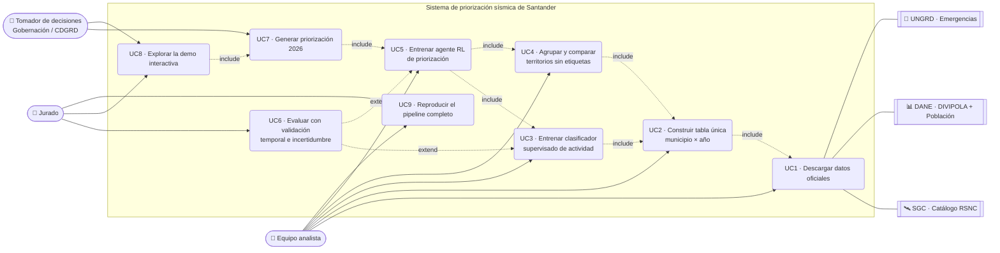

# 01 · Diagrama de casos de uso

Actores:
- **Equipo analista:** construye y entrena.
- **Jurado:** verifica y evalúa.
- **Tomador de decisiones:** Gobernación de Santander, CDGRD o alcaldías, que usan la priorización.
- **Sistemas externos:** fuentes oficiales.

| Caso de uso | Disparador | Resultado verificable |
|---|---|---|
| UC1 | `python src/01_descarga_sgc.py`, `python src/02_descarga_fuentes_complementarias.py` | `data/raw/*` + `metadata_*.json` (URL, fecha, filtros) |
| UC2 | `python src/03_tabla.py` | `data/processed/dataset_santander.csv` + `docs/diccionario_datos.csv` |
| UC3 | `python src/04_supervisado.py` | `models/supervisado.joblib`, `reports/metricas_supervisado.json` |
| UC4 | `python src/05_no_supervisado.py` | `data/processed/clusters_municipios.csv`, `reports/metricas_no_supervisado.json` |
| UC5 | `python src/06_agente_rl.py` | `models/agente_rl.npz`, `reports/metricas_rl.json` |
| UC6 | incluido en UC3 y UC5 | métricas en el conjunto de prueba 2020–2024 y comparación contra líneas base |
| UC7 | incluido en UC5 | `data/processed/priorizacion_2026.csv` |
| UC8 | `streamlit run app/app.py` | app con 5 pestañas |
| UC9 | `python run_all.py` | regenera todo con semillas fijas |
