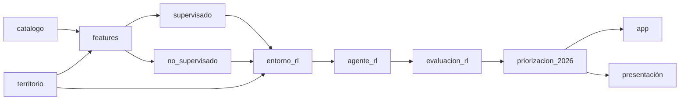

# 02 · Diagrama de componentes y paquetes

Arquitectura en capas: **scripts de entrada** (numerados, orquestan) → **paquete `sismo`** (lógica reutilizable y testeable) → **artefactos** (archivos en disco). La app **solo lee artefactos**: nunca entrena.

```mermaid
flowchart TB
    subgraph EXT["Fuentes oficiales (externas)"]
        SGC[(SGC RSNC<br/>bdrsnc.sgc.gov.co)]
        DATOS[(datos.gov.co<br/>DIVIPOLA · UNGRD)]
        DANEW[(dane.gov.co<br/>Proyecciones población)]
    end

    subgraph SCRIPTS["src/ · scripts de entrada"]
        S01[01_descarga_sgc.py ✅]
        S02[02_descarga_fuentes_complementarias.py ✅]
        S03[03_tabla.py]
        S04[04_supervisado.py]
        S05[05_no_supervisado.py]
        S06[06_agente_rl.py]
        S07[07_presentacion.py]
        RUN[run_all.py]
    end

    subgraph PKG["src/sismo/ · paquete"]
        CFG[config.py<br/>constantes y rutas]
        CAT[catalogo.py<br/>unificar catálogos]
        TER[territorio.py<br/>municipios · DANE · UNGRD]
        FEA[features.py<br/>tabla municipio×año]
        SUP[supervisado.py]
        NOS[no_supervisado.py]
        ENV[entorno_rl.py<br/>PriorizacionEnv]
        AGE[agente_rl.py<br/>AgentePoliticaLineal]
        EVA[evaluacion_rl.py<br/>líneas base + métricas]
    end

    subgraph ART["Artefactos"]
        RAW[(data/raw)]
        INT[(data/interim)]
        PRO[(data/processed)]
        MOD[(models)]
        REP[(reports + figures)]
        DOC[(docs)]
    end

    APP[app/app.py<br/>Streamlit]
    TST[tests/ · pytest]

    SGC --> S01 --> RAW
    DATOS --> S02
    DANEW --> S02 --> RAW
    S03 --> CAT & TER & FEA
    CAT --> INT
    TER --> INT
    FEA --> PRO & DOC
    S04 --> SUP --> MOD & REP & PRO
    S05 --> NOS --> PRO & REP
    S06 --> ENV & AGE & EVA
    EVA --> REP & PRO
    AGE --> MOD
    S07 --> DOC
    RUN --> S03 & S04 & S05 & S06 & S07
    CFG -.usa.-> CAT & TER & FEA & SUP & NOS & ENV & AGE & EVA
    APP --> PRO & REP
    TST -.prueba.-> PKG
```



## Dependencias entre componentes (orden de ejecución)



## Estructura de carpetas objetivo

```
Hackathon-uts/
├── README.md                     # cómo correr, fuentes citadas, limitaciones
├── requirements.txt
├── run_all.py                    # pipeline completo (03→07)
├── app/app.py                    # demo Streamlit
├── src/
│   ├── 01_descarga_sgc.py        ✅
│   ├── 02_descarga_fuentes_complementarias.py ✅
│   ├── 03_tabla.py  04_supervisado.py  05_no_supervisado.py
│   ├── 06_agente_rl.py  07_presentacion.py
│   └── sismo/
│       ├── __init__.py  config.py  catalogo.py  territorio.py  features.py
│       ├── supervisado.py  no_supervisado.py
│       └── entorno_rl.py  agente_rl.py  evaluacion_rl.py
├── tests/  test_catalogo.py  test_territorio.py  test_features.py
│          test_supervisado.py  test_no_supervisado.py  test_entorno_rl.py  test_agente_rl.py
├── data/raw/ (crudos)  data/interim/  data/processed/
├── models/  reports/  reports/figures/
└── docs/  PLAN.md  PLAN_IMPLEMENTACION.md  CONTRATOS_DATOS.md  diccionario_datos.csv
          uml/  presentacion.pptx
```
