# 03 · Diagrama de clases (contratos de interfaz)

```mermaid
classDiagram
    direction LR

    class config {
        <<module>>
        +ROOT, RAW, INTERIM, PROCESSED, MODELS, REPORTS, FIGURES : Path
        +BOX : dict
        +NIDO_LAT = 6.8
        +NIDO_LON = -73.1
        +MAG_MIN = 2.5
        +ANIO_INICIO = 2002
        +ANIO_FIN = 2025
        +TRAIN, VAL, TEST : tuple~int,int~
        +UMBRAL_MEDIO = 1
        +UMBRAL_ALTO = 5
        +RMS_MAX = 2.0
        +ERR_PROF_MAX = 50.0
        +COD_DPTO_SANTANDER = "68"
        +K_PRESUPUESTO = 10
        +SEMILLAS : list~int~
        +FEATURES_SUP : list~str~
        +FEATURES_PERFIL : list~str~
        +FEATURES_RL : list~str~
    }

    class catalogo {
        <<module>>
        +leer_catalogo_antiguo(path: Path) DataFrame
        +leer_catalogo_nuevo(path: Path) DataFrame
        +unificar(antiguo: DataFrame, nuevo: DataFrame) DataFrame
        +marcar_atipicos(eventos: DataFrame) DataFrame
        +construir_eventos() DataFrame
    }

    class territorio {
        <<module>>
        +cargar_divipola(path: Path) DataFrame
        +municipios_en_caja(divipola: DataFrame) DataFrame
        +cargar_poblacion(path: Path) DataFrame
        +cargar_emergencias(paths: list~Path~) DataFrame
        +asignar_municipio(eventos: DataFrame, municipios: DataFrame) DataFrame
        +distancia_km(lat1, lon1, lat2, lon2) ndarray
        +construir_municipios() DataFrame
    }

    class features {
        <<module>>
        +b_value_aki(mags: ndarray, mc: float) float
        +agregar_anual(eventos: DataFrame, municipios: DataFrame) DataFrame
        +agregar_rezagos(panel: DataFrame) DataFrame
        +agregar_objetivo(panel: DataFrame) DataFrame
        +nivel_actividad(n: Series) Series
        +unir_territorio(panel: DataFrame, municipios: DataFrame) DataFrame
        +diccionario_datos() DataFrame
        +construir_dataset() DataFrame
    }

    class supervisado {
        <<module>>
        +dividir_temporal(df: DataFrame) dict~str,DataFrame~
        +lineas_base(df_test: DataFrame) dict
        +seleccionar_modelo(train, val) tuple~estimator,dict~
        +evaluar(modelo, df: DataFrame) dict
        +importancias(modelo, df: DataFrame) DataFrame
        +predecir_walkforward(df: DataFrame, params: dict) DataFrame
        +ejecutar() dict
    }

    class no_supervisado {
        <<module>>
        +perfil_municipal(df: DataFrame, anios: tuple) DataFrame
        +elegir_k(X: ndarray, ks: range) DataFrame
        +ajustar_clusters(perfil: DataFrame, k: int) tuple~DataFrame,dict~
        +nombrar_clusters(perfil: DataFrame) dict~int,str~
        +comparacion_territorial(perfil: DataFrame) DataFrame
        +importancia_variables(perfil: DataFrame) DataFrame
        +fuentes_dbscan(eventos: DataFrame) DataFrame
        +ejecutar() dict
    }

    class PriorizacionEnv {
        <<gymnasium.Env>>
        +estados : dict~int, ndarray~
        +recompensas : dict~int, ndarray~
        +anios : list~int~
        +k : int
        +n_mpios : int
        +n_feat : int
        +observation_space : Box
        +action_space : Discrete
        -_anio : int
        -_elegidos : ndarray~bool~
        +reset(seed, options) tuple~ndarray,dict~
        +step(accion: int) tuple~ndarray,float,bool,bool,dict~
        +mascara() ndarray~bool~
        +oraculo(anio: int) float
        +topk_oraculo(anio: int) ndarray~int~
    }

    class AgentePoliticaLineal {
        +w : ndarray
        +lr : float
        +entropia : float
        +rng : Generator
        -_baseline : ndarray
        +puntajes(x: ndarray) ndarray
        +politica(x: ndarray, mascara: ndarray) ndarray
        +actuar(x: ndarray, mascara: ndarray, greedy: bool) int
        +actualizar(trayectoria: list~tuple~) float
        +contribuciones(x: ndarray) ndarray
        +guardar(path: Path) None
        +cargar(path: Path)$ AgentePoliticaLineal
    }

    class evaluacion_rl {
        <<module>>
        +construir_estados(df, pred, clusters, anios) tuple~dict,dict,list~str~~
        +entrenar(env, agente, n_epocas, anios_val) DataFrame
        +evaluar_politica(env, politica_fn, anios) dict
        +lineas_base(nombres_feat) dict~str,callable~
        +priorizar(agentes, x_2025, municipios) DataFrame
        +ejecutar() dict
    }

    catalogo ..> config
    territorio ..> config
    features ..> catalogo
    features ..> territorio
    supervisado ..> features
    no_supervisado ..> features
    evaluacion_rl ..> supervisado : predicciones walk-forward
    evaluacion_rl ..> no_supervisado : cluster_rl
    evaluacion_rl --> PriorizacionEnv : crea
    evaluacion_rl --> AgentePoliticaLineal : entrena 1 por semilla
    AgentePoliticaLineal ..> PriorizacionEnv : interactúa
```

Las **firmas de este diagrama son contrato**. Los subagentes las implementan *exactamente* así (nombres, parámetros, tipos de retorno). Los módulos de funciones aparecen como clases con estereotipo `<<module>>`.

## Semántica clave de las clases RL

### `PriorizacionEnv(estados, recompensas, anios, k=10)`
- `estados[anio]`: `ndarray (n_mpios, n_feat)` **ya estandarizado** (con media y desviación de los años de entrenamiento). Las filas siguen el orden de `municipios_santander` (87, ordenados por `cod_mpio`).
- `recompensas[anio]`: `ndarray (n_mpios,)` ≥ 0 = **riesgo realizado en t+1** (ver `CONTRATOS_DATOS.md §6`). El agente **nunca** lo observa.
- **Observación:** `ndarray (n_mpios, n_feat + 2)` = `[estado | elegido(0/1) | presupuesto_restante/k]`.
- **Acción:** `Discrete(n_mpios)`, el índice del municipio.
- `step`:
  - Acción válida: recompensa = `recompensas[anio][a]` y se marca el municipio como elegido.
  - Acción inválida (ya elegido): recompensa `-1.0` y el estado no cambia.
  - `terminated = (elegidos == k)`, `truncated = False`.
  - `info = {"anio", "mascara", "seleccion"}`.
- `reset(seed=None, options=None)`: `options={"anio": int}` fija el año. Si no se pasa, se sortea uno de `anios` con `self.np_random`.
- `oraculo(anio)`: suma de las k recompensas más altas (techo teórico).

### `AgentePoliticaLineal(n_feat, lr=0.05, entropia=0.01, seed=0)`
- **Política:** `π(i | s) = softmax(w · x_i)` sobre los municipios **no elegidos** (los enmascarados reciben −∞).
- `actualizar(trayectoria)` con `trayectoria = [(x, mascara, accion, recompensa), ...]`:
  - REINFORCE con línea base. Retorno `G_t = Σ_{τ≥t} r_τ` (γ = 1).
  - La línea base `b_t` es una media móvil exponencial (α = 0,05) de `G_t` por paso t.
  - Gradiente: `∇ log π(a) = x_a − Σ_j π_j x_j`.
  - Regla: `w += lr · (G_t − b_t) · ∇ log π(a) + entropia · ∇H`.
  - Devuelve la recompensa total del episodio.
- `contribuciones(x)`: `x * w` (n_mpios, n_feat). Sirve para la explicación por criterio.
