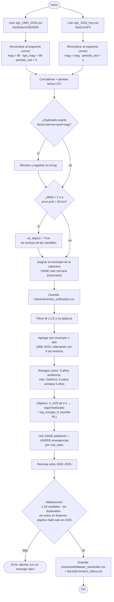
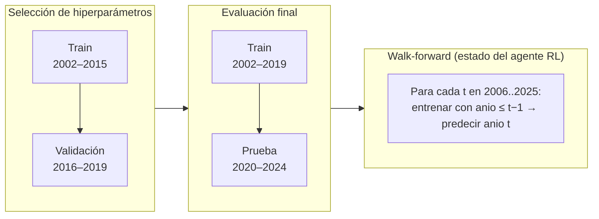
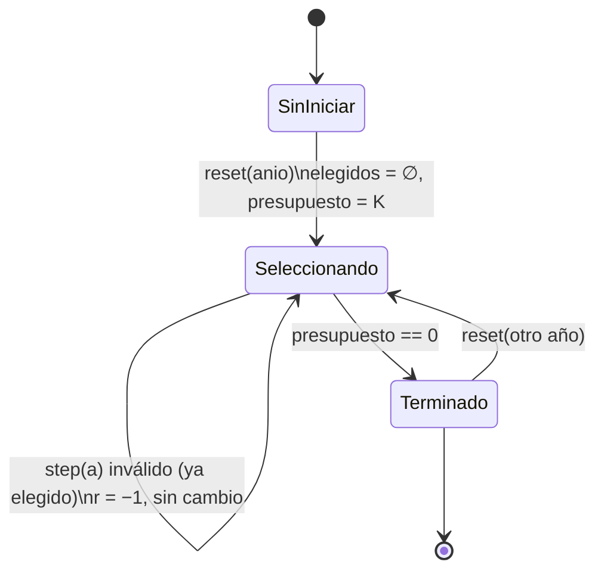
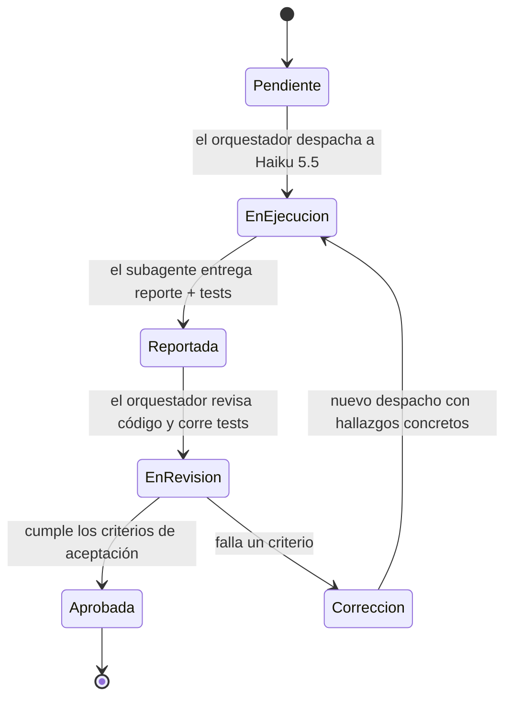

# 05 · Diagramas de actividad y de estados

## 5.1 Actividad: limpieza y construcción de la tabla única (`03_tabla.py`)

## 5.2 Actividad: validación temporal (supervisado)

> La fila del año `t` predice la actividad de `t+1`. Al final del año `t`, las filas `anio ≤ t−1` ya tienen su objetivo observado, así que el walk-forward **no usa información futura**.

## 5.3 Estados: episodio del entorno `PriorizacionEnv`

## 5.4 Estados: ciclo de vida de una tarea de subagente (orquestación)

