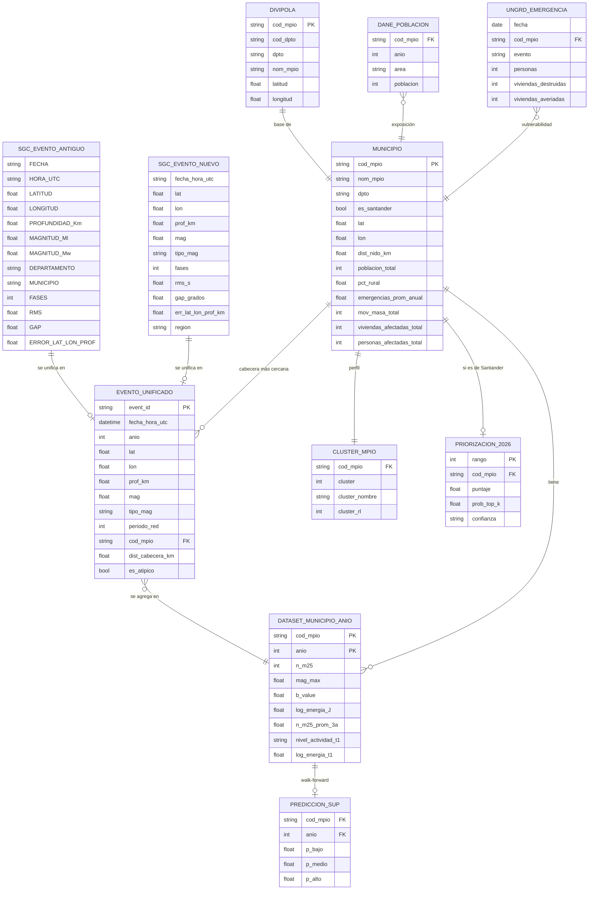

# 06 · Modelo de datos (entidad-relación)

Cómo se integran las fuentes oficiales en una **tabla única**. La llave de integración es `cod_mpio` (DIVIPOLA, texto de 5 dígitos con ceros a la izquierda, p. ej. `"68001"`).

El detalle de columnas, tipos y unidades está en [`../CONTRATOS_DATOS.md`](../CONTRATOS_DATOS.md).
